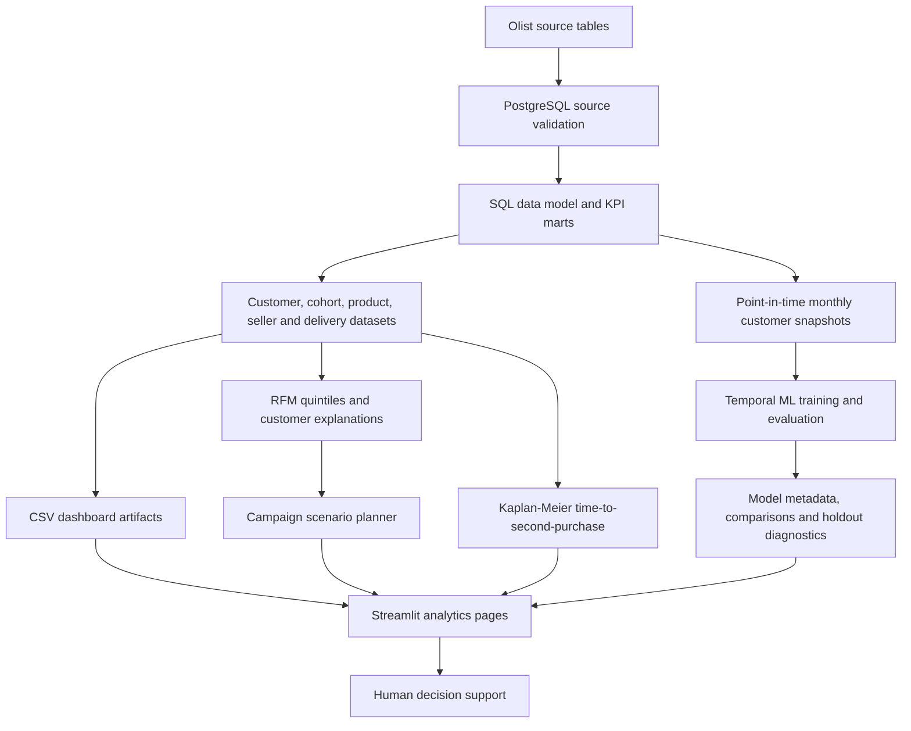

# System architecture

## Trust boundaries and interpretation
- Source timestamps and delivered-order definitions are validated before SQL rebuilds.
- ML predictors are point-in-time; future orders are used only to define the outcome.
- Temporal partitions use a 90-day label-horizon embargo and the final test is held out from model selection.
- RFM segments are descriptive rules and relative scores, not causal personas.
- Survival analysis treats customers without a second observed purchase by the data end as right-censored.
- Campaign lift and unit economics are explicit scenario assumptions. No randomized campaign exposure exists in Olist, so outputs are not causal uplift estimates.
- v6 remains research-only because holdout PR-AUC (0.01048) did not beat lifetime-frequency (0.01665).
